# Data model

The schema lives in `supabase/migrations/` (one file per change, applied in order); that folder is
the source of truth and this page is a map of it. Sport rules (formations, position codes, point
values) live in `src/sports/` and are mirrored in SQL only where the database must enforce them
(`score_event_points`). Authorization is Postgres RLS plus `SECURITY DEFINER` functions, no app server.

## ERD

```mermaid
erDiagram
  auth_users ||--o| profiles : "id (cascade)"
  auth_users ||--o{ teams : "owner_id"
  auth_users ||--o{ team_members : "user_id (cascade)"
  auth_users ||--o{ player_guardians : "user_id (cascade)"
  auth_users ||--o{ join_attempts : "user_id (cascade)"
  teams |o--o{ profiles : "last_team_id (set null)"
  teams ||--o{ seasons : "team_id (cascade)"
  teams ||--o{ team_members : "team_id (cascade)"
  teams ||--o{ players : "team_id (cascade)"
  teams ||--o{ games : "team_id (cascade)"
  teams ||--o{ lineups : "team_id (cascade)"
  teams ||--o{ skill_tests : "team_id (cascade)"
  teams ||--o{ practices : "team_id (cascade)"
  players |o--o| teams : "last_batter_player_id (set null)"
  seasons ||--o{ games : "season_id (no action)"
  seasons ||--o{ practices : "season_id (no action)"
  team_members ||--o{ unlisted_child_requests : "member_id (cascade)"
  players ||--o{ player_guardians : "player_id (cascade)"
  players ||--o{ game_players : "player_id (no action)"
  players ||--o{ plate_appearances : "player_id (no action)"
  players ||--o{ skill_results : "player_id (cascade)"
  players |o--o{ lineup_slots : "player_id (set null)"
  players |o--o{ score_events : "scorer / assist (set null)"
  games ||--o| game_coach_notes : "game_id (cascade)"
  games ||--o{ game_players : "game_id (cascade)"
  games |o--o{ lineups : "game_id (cascade; null = template)"
  games ||--o{ score_events : "game_id (cascade)"
  games ||--o{ plate_appearances : "game_id (cascade)"
  lineups ||--o{ lineup_slots : "lineup_id (cascade)"
  skill_tests ||--o{ skill_results : "skill_test_id (restrict)"

  auth_users {
    uuid id PK
    text email
    timestamptz email_confirmed_at
  }
  profiles {
    uuid id PK "= auth.users.id"
    text display_name
    theme theme "light | dark | auto"
    field_view field_view "persp | flat"
    uuid last_team_id FK
    boolean is_platform_admin "SQL editor only"
  }
  teams {
    uuid id PK
    text name
    sport sport "soccer | baseball | basketball | lacrosse | football"
    uuid owner_id FK
    text join_code UK "8 chars A-Z 2-9"
    timestamptz join_code_rotated_at
    int side_size
    boolean has_gk
    int periods_count
    jsonb colors
    uuid last_batter_player_id FK
    timestamptz archived_at
  }
  seasons {
    uuid id PK
    uuid team_id FK
    text name
    date starts_on
    date ends_on
    boolean is_current "unique per team"
  }
  team_members {
    uuid id PK
    uuid team_id FK
    uuid user_id FK "unique with team_id"
    member_role role "coach | assistant | parent"
    member_status status "pending | active | removed"
    member_role requested_role
    text note
    uuid approved_by
    timestamptz approved_at
  }
  players {
    uuid id PK
    uuid team_id FK
    text first_name
    text last_name
    text jersey_number "0-3 digits"
    boolean is_available
    int batting_order
    int sort_order
    timestamptz archived_at "soft delete"
  }
  player_guardians {
    uuid id PK
    uuid player_id FK
    uuid user_id FK "unique with player_id"
    text relationship
    guardian_status status "pending | approved"
    text unlisted_child_name
  }
  unlisted_child_requests {
    uuid id PK
    uuid member_id FK
    text child_name
  }
  games {
    uuid id PK
    uuid team_id FK
    uuid season_id FK
    text opponent
    date game_date
    time start_time
    text location
    home_away home_away "home | away | neutral"
    text parent_notes
    game_status status "upcoming | live | done; one live per team"
    text team_name_snapshot
    timestamptz started_at
    timestamptz finished_at
  }
  game_coach_notes {
    uuid game_id PK
    text notes "staff only"
  }
  game_players {
    uuid game_id PK
    uuid player_id PK
    text name_snapshot
    text number_snapshot
    boolean available
  }
  lineups {
    uuid id PK
    uuid team_id FK
    uuid game_id FK "null = team template"
    int period_index "unique with team + game"
    text formation_name
  }
  lineup_slots {
    uuid lineup_id PK
    int slot_index PK
    text position_role
    text position_code
    uuid player_id FK "once per lineup"
    boolean auto_picked
  }
  score_events {
    uuid id PK
    uuid game_id FK
    score_side side "us | them"
    int period_index
    text event_type "per sport"
    smallint points "derived by trigger"
    uuid scorer_player_id FK
    uuid assist_player_id FK
    timestamptz occurred_at
    uuid created_by
  }
  plate_appearances {
    uuid id PK
    uuid game_id FK
    uuid player_id FK
    int inning
    int sequence
    pa_result result
    smallint rbi
    uuid created_by
  }
  skill_tests {
    uuid id PK
    uuid team_id FK
    text key "unique with team_id"
    text name
    text instructions
    skill_metric metric "count | time_seconds | distance | made_of_attempted"
    text unit "yd | ft | m"
    boolean has_sides
    boolean higher_is_better
    int attempts
    int sort_order
    boolean is_active
  }
  skill_results {
    uuid id PK
    uuid player_id FK
    uuid skill_test_id FK
    date tested_on
    numeric value
    numeric attempts
    body_side side "left | right"
    text note
    uuid recorded_by
  }
  join_attempts {
    bigint id PK
    uuid user_id FK
    text code_tried
    timestamptz attempted_at
  }
  practices {
    uuid id PK
    uuid team_id FK
    uuid season_id FK
    date practice_date
    time start_time
    time end_time
    text location
    text notes
    practice_status status "scheduled | cancelled"
    uuid created_by
  }
```

Every table also carries `created_at` and, where rows are edited, `updated_at` (kept current by a
`set_updated_at` trigger) and `updated_by`. Those are left out of the diagram for space.

## Who can do what

The membership helpers in `0200_helpers_and_triggers.sql` (redefined for admins in
`0900_platform_admin.sql`) are `SECURITY DEFINER` so policies can consult `team_members` without
recursing into its own policies:

| Helper                                  | Meaning                                                                        |
| --------------------------------------- | ------------------------------------------------------------------------------ |
| `member_role_on(team)`                  | the caller's active role on the team; `coach` for a platform admin everywhere  |
| `is_active_member(team)`                | any active role                                                                |
| `is_staff(team)`                        | coach or assistant                                                             |
| `is_coach(team)`                        | coach only                                                                     |
| `is_owner(team)`                        | `teams.owner_id` is the caller, or the caller is a platform admin              |
| `is_guardian_of(player)`                | an approved `player_guardians` link                                            |
| `team_of_game/player/lineup/skill_test` | the team a row belongs to, for policies on child tables                        |
| `email_confirmed(user)`                 | email verified (automatic with confirmations off); checked by `approve_member` |
| `is_platform_admin()`                   | `profiles.is_platform_admin` of the caller                                     |

RLS in `0300_rls.sql` (and `1000_practices.sql`) follows one rule: **read = active membership,
write = coach or assistant**, with these exceptions:

- `profiles`: own row only (names of other members come through `list_team_members()`).
- `teams`: insert only by a platform admin (`create_team()` checks it and an insert policy backs it up, D48); delete only by the owner.
- `team_members`: a member sees their own row, staff see all; insert only through
  `create_team()` / `request_join()` (parent requests only, D49); update and delete by coaches.
  Approvals (`approve_member`, `decline_member`, `approve_guardian_link`) are for coach, assistant
  and admin; only a coach may approve someone as an assistant or coach.
- `player_guardians` and `unlisted_child_requests`: own rows or staff; writes by coaches
  (parents request links through RPCs).
- `game_coach_notes`: staff only, in every direction; parents cannot read it.
- `skill_results`: staff read and write; a parent reads only children they are an approved guardian of.
- `practices`: members read, staff insert and update, **only a platform admin deletes** (coaches cancel).
- `player_details`: staff or an approved guardian of that player, read and write; nothing for
  anyone else (D52).
- `player_contacts`: writes by staff or an approved guardian; reads by them always, and by any
  active member of the team while `share_with_team` is on (D57).
- `score_events` / `plate_appearances`: readable directly only by staff, or by parents when
  `teams.parent_stats = 'team'`. Parents on an `own` team read them through `game_events()`,
  `game_plate_appearances()` and `game_scores_for()`, which withhold other children's ids;
  `player_season_stats()` returns only the rows they may see (D56).
- `join_attempts`: no policies at all; only the definer functions touch it.
- `lookup_invite(code)` is callable by `anon`: it returns the team name, sport, roster first names
  and whether the invite is on, so the invite link can show the child picker before an account
  exists (D49). `teams.join_enabled` is the on/off switch (`set_join_enabled`, coach only);
  `rotate_join_code` replaces the code and turns the invite back on.

Realtime is published for `games`, `score_events`, `plate_appearances`, `lineups`, `lineup_slots`,
`team_members`, `player_guardians`, `players`, `skill_tests`, `skill_results` and `practices`.

## Tables

### profiles

One row per auth user, created by the `on_auth_user_created` trigger (`handle_new_user`). Holds the
display name, theme and field-view preferences, the last team opened, and `is_platform_admin`.
Trigger `profiles_guard_admin_flag` refuses any change to the admin flag made with a JWT, so the flag
can only be set from the SQL editor. Written by the user themselves and by `create_team()` /
`transfer_ownership()` (last team).

### teams

The team and its settings (sport, side size, goalkeeper, periods, colours, `timezone` for calendar
exports — default America/Chicago, D50), the owner, the join code and `join_enabled` (D49). Created only by `create_team()`, which also inserts the owner's coach membership, the first
season, the template lineups and the sport's default skill tests. Trigger `teams_guard_update`:
`owner_id` changes only inside `transfer_ownership()`; name by a coach; sport by a platform admin
(`admin_change_sport()`); archive by the owner. RPCs: `rotate_join_code`, `transfer_ownership`,
`admin_change_sport`, `import_legacy_backup` (settings).

### seasons

Date ranges that scope games, practices and stats; exactly one `is_current` per team (partial unique
index). Staff write directly. Games and practices reference a season without cascade, so a season
with games cannot be deleted.

### team_members

Membership and its approval state. Rows are created by `create_team()` (owner as coach) and
`request_join()` (pending, with the requested role), then changed by `approve_member`,
`decline_member`, `remove_member` (sets `removed`), `set_member_role`, `transfer_ownership` and
`admin_add_member`. Trigger `team_members_keep_a_coach` blocks the update or delete that would leave
an existing team without an active coach. `unique (team_id, user_id)`.

### players

The roster. `archived_at` is the soft delete (`archive_player()`): past games keep their snapshots,
the template and any live game drop the player (`clear_player_from_plans`). `is_available` is the
"out" switch (`set_player_available()`); `batting_order` is baseball's locked order
(`set_batting_order()`). Trigger `players_stamp` writes `updated_by`.

### player_guardians

Which users may see which child. Created pending by `request_join()` and `request_guardian_link()`,
approved by `approve_member()` / `approve_guardian_link()`. `is_guardian_of()` reads only approved
links; it gates `skill_results` for parents.

### unlisted_child_requests

A join request for a child who is not on the roster yet: the free-text name hangs off the pending
membership until the coach adds the player and links them. Deleted by coaches or with the membership.

### games

Schedule and status of a game. `address` (optional, ≤ 200 chars) feeds the Directions link and the
calendar export; `team_places(team)` lists the location/address pairs a team has used (D50). `start_game()` copies the template lineups into the game, snapshots
the roster into `game_players`, sets `live` (one live game per team, partial unique index).
`finish_game()` re-snapshots, sets `done`, and copies the final lineups back as the new template.
Schedule fields (`start_time`, `location`, `home_away`, `parent_notes`) are edited directly by
staff. Trigger `games_stamp` writes `updated_by`.

### game_coach_notes

Private coaching notes, one row per game, staff only (its own table so RLS can hide it from
parents). Trigger `game_coach_notes_stamp` keeps `updated_by`.

### game_players

Name and number snapshot per game so a renamed or removed player still reads correctly in history.
Written by `snapshot_game_players()` from `start_game` / `finish_game`.

### lineups and lineup_slots

A lineup is one period's formation; `game_id` null is the team's template plan, otherwise the
game's own copy. Slots hold the position role/code and the player (at most once per lineup,
partial unique index). Written atomically by `save_lineups()` (last write wins), `copy_lineups()`,
`create_team()`, `admin_change_sport()` and `import_legacy_backup()`. Trigger
`lineup_slots_validate` requires the player to be on the lineup's team.

### score_events

The scoring log; the score of a game is always the sum of this table (`game_scores` and
`game_line_score` views). Trigger `score_events_validate` derives `points` from the sport and
`event_type` (`score_event_points`), strips players from opponent events, and checks scorer and
assist belong to the team. Staff insert, update and delete rows directly.

### plate_appearances

Baseball batting log, independent of runs in `score_events`. Trigger `plate_appearances_validate`
allows baseball teams only and checks the batter is on the team.

### skill_tests

A team's own copy of its skill tests, seeded from `default_skill_tests(sport)` by `create_team()`
and the 0800 backfill; `restore_skill_tests()` re-adds or un-hides defaults, `set_skill_test_order()`
reorders. Trigger `skill_tests_guard`: once a test has results its metric, direction, unit,
attempts and sides are locked, and it cannot be deleted (hide it with `is_active = false`).

### skill_results

Append-only history of recorded results (`value`, optional `attempts` and `side`). Staff write
directly; `recorded_by` never changes (`skill_results_stamp`). Personal bests are computed in the
client.

### player_details and player_contacts

Private data for one player (D52): `player_details` (one row per player: `birthdate`,
`shirt_size` youth XS → adult XL) and `player_contacts` (name, relationship, email, phone, an
optional `user_id` link to an app account). One policy each: `can_see_player_private(player)` =
staff of the player's team (admins included) **or an approved guardian of that player**, for every
operation. Another parent on the same team reads nothing of the details and cannot insert; pgTAP 10 proves it.
Contacts carry `share_with_team` (default on, D57): when on, every active member of the team may
read that contact's name, relationship, phone and email; writes stay with staff and guardians.
`team_members.contact_phone` holds the phone typed on the invite; `approve_member` turns it into a
contact on each linked child. `roster_directory`, `player_people` and `team_sheet` are the read
functions behind the directory, the contact card and the staff-only sheet; pgTAP 12 covers them.

### join_attempts

Rate-limit log for join codes: `record_join_attempt()` refuses a sixth attempt within ten minutes.
No policies; only the definer functions read or write it.

### practices

Training sessions beside games (`scheduled` or `cancelled`, never deleted by a coach). Triggers:
`practices_stamp` (audit columns, `team_id` and `season_id` frozen after insert) and
`practices_check_season` (the season must belong to the team).

## Views and functions

| Name                                                                                                                                      | What it does                                                                                   |
| ----------------------------------------------------------------------------------------------------------------------------------------- | ---------------------------------------------------------------------------------------------- |
| `game_scores` (view)                                                                                                                      | us / them totals per game from `score_events` (security invoker)                               |
| `game_line_score` (view)                                                                                                                  | points per game, period and side                                                               |
| `player_season_stats(team, season?, game?)`                                                                                               | one row per player with the sport's stat columns, for a season or one game; runs as the caller |
| `default_skill_tests(sport)`                                                                                                              | the sport's default test set as JSON (kept in step with `src/skills/defaults.ts`)              |
| `create_team(...)`                                                                                                                        | team + owner membership + season + template lineups + default tests                            |
| `lookup_join_code`, `request_join`, `request_guardian_link`, `record_join_attempt`                                                        | the parent/assistant join flow                                                                 |
| `approve_member`, `decline_member`, `remove_member`, `set_member_role`, `approve_guardian_link`, `rotate_join_code`, `transfer_ownership` | coach membership actions                                                                       |
| `my_pending_requests`, `list_team_members`                                                                                                | directory helpers (profiles are private)                                                       |
| `save_lineups`, `copy_lineups`, `clear_player_from_plans`, `set_player_available`, `archive_player`                                       | lineup and roster writes that touch several rows                                               |
| `start_game`, `finish_game`, `snapshot_game_players`                                                                                      | game lifecycle                                                                                 |
| `set_batting_order`                                                                                                                       | baseball order                                                                                 |
| `set_skill_test_order`, `restore_skill_tests`                                                                                             | skills settings                                                                                |
| `import_legacy_backup`                                                                                                                    | loads a normalised `mini-messis-coach-v5` backup into a team                                   |
| `is_platform_admin`, `admin_list_teams`, `admin_list_users`, `admin_add_member`, `admin_change_sport`                                     | platform admin console (D39)                                                                   |
| `generate_join_code`, `normalize_join_code`, `score_event_points`, `email_confirmed`                                                      | pure helpers                                                                                   |

Launch scripts that read this schema: `scripts/reset-strikers-for-launch.sql` (backup to
`backup_prelaunch`, then wipe everything but the Strikers' roster, schedule and settings) and
`scripts/restore-from-prelaunch-backup.sql`.
